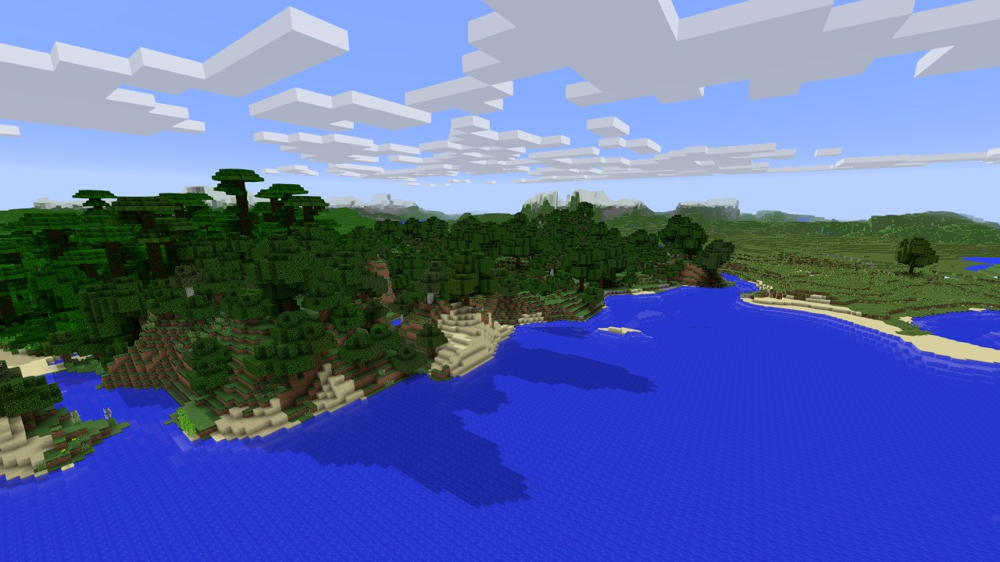

# mc-rs

Minecraft 1.12.2, rebuilt in Rust. It generates the same worlds as the original game from the
same seed, draws them with the game's own textures and lighting, and lets friends play together
in a browser.



> **A note on AI:** this project leans heavily on AI development. If you are against AI, mc-rs
> may not be for you.

Why it exists and what it aims for: [docs/PURPOSE.md](docs/PURPOSE.md).

## What it does

- **Same worlds as 1.12.2.** Terrain, biomes, caves, ravines, lakes, ores, trees and plants match
  the original game block for block for any seed (default world type, overworld).
- **The 1.12.2 look.** Block models and textures, smooth lighting, biome colors, water and lava,
  sky, fog, fancy clouds, the day cycle and the first-person hand, read from your own copy of
  the game. Optional extras: sun shadows, anti-aliasing and distant terrain past the render
  distance.
- **Creative play.** Walk, sprint, sneak, fly, break and place blocks, pick blocks and use the
  hotbar, with block sounds, music and break particles.
- **Play in a browser.** `mc-rs-server` hosts a shared world on your PC and streams the game to
  each friend's browser, like a cloud gaming service. Friends sign in with a name and password,
  see each other, chat and build together. Phones get touch controls.
- **A launcher.** `mc-rs-launcher.exe` installs the game, finds or downloads the 1.12.2 game files from
  Mojang, and updates itself.

## Requirements

- **A Minecraft: Java Edition account.** mc-rs uses the textures, models and sounds of the
  1.12.2 client, read at startup from your own installed copy of the game. The game is sold at
  [minecraft.net](https://www.minecraft.net).
- Windows 10 or 11, 64-bit, with a graphics card that supports Vulkan or DirectX 12.
- The 1.12.2 client: in the official Minecraft Launcher, add an installation for release 1.12.2
  and start it once. Prism Launcher's 1.12.2 instances also work.

## Getting it

**Download:** `mc-rs-launcher.exe` from the [latest release](https://github.com/haunterdev/mc-rs/releases/latest). Run it, press Play, and it installs the game and finds or downloads the 1.12.2 files. It also joins friends' servers (Join a server) and updates itself.

**Or build it from source** with the [build guide](docs/guides/building.md). The guide covers building by
hand and building with an AI coding agent (Google Antigravity, OpenAI Codex, Claude Code, Cursor
and similar).

The short version, with [Rust](https://rustup.rs) installed:

```
git clone https://github.com/haunterdev/mc-rs
cd mc-rs
cargo run --release -p viewer
```

## Controls

| Key | Action |
|---|---|
| Click into the window | capture the mouse |
| W A S D | walk |
| Space | jump; double tap to fly, then up |
| Shift | sneak; down while flying |
| Ctrl | sprint |
| Left click | break |
| Right click | place |
| Middle click | pick block |
| Wheel or 1 to 9 | hotbar slot |
| Esc | options |
| F5 | third person |
| F3 or H | stats |
| F1 | hide the GUI |
| + and - | render distance |

In a browser, T or Enter opens chat and Tab lists who is online.

## Hosting a world for friends

[docs/guides/hosting.md](docs/guides/hosting.md) covers the server: what it needs (ffmpeg and
cloudflared), starting it with `Start Server.bat`, accounts, settings and the public link.

## Project layout

| Folder | Holds |
|---|---|
| `crates/worldgen` | world generation: biomes, terrain, caves, ravines and population |
| `crates/sim` | game rules shared by the client and the server: collision, block ray tracing, terrain, entities, the player inventory |
| `crates/items` | items and blocks as data: the registries, tools and digging, drops, crafting, smelting, food |
| `crates/jar` | reading the 1.12.2 client jar into memory |
| `crates/viewer` | the game client (Bevy): rendering, player, building, sound |
| `crates/server` | the browser server and its web page |
| `crates/launcher` | `mc-rs-launcher.exe`: install, game files, updates |
| `crates/proto` | messages between the server and game sessions |
| `crates/paths`, `crates/brand` | file locations on a player's PC; the icon and Windows resources |
| `harness/`, `tools/` | the test fixture harness, benchmarks, packaging and test scripts |
| `docs/` | guides, notes and the [benchmark](docs/BENCHMARK.md) |

`CLAUDE.md` maps every source file to the system it owns, for people and coding agents alike.

## Legal

NOT AN OFFICIAL MINECRAFT PRODUCT. NOT APPROVED BY OR ASSOCIATED WITH MOJANG OR MICROSOFT.

Minecraft is a trademark of Mojang Synergies AB. Use of the Minecraft name and game files is
governed by Mojang's [Minecraft Usage Guidelines](https://www.minecraft.net/en-us/usage-guidelines)
and the [Minecraft EULA](https://www.minecraft.net/en-us/eula).

- You need to own Minecraft: Java Edition to use mc-rs.
- This repository and the releases built from it contain no Minecraft game files: no client
  jar, textures, models, sounds or music. mc-rs reads them at runtime from your own installed
  copy of the game and keeps them in memory. When no copy is found, the launcher offers to
  download the 1.12.2 client from Mojang's own servers into its data folder.
- mc-rs is free and is not sold.

mc-rs is free software under the [GNU General Public License v3.0 or later](LICENSE): you can
use, study, share and change it, and versions you share stay under the same license.
